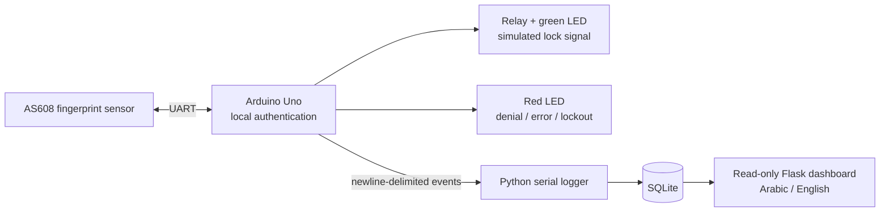

# Fingerprint Access Dashboard

A bench-safe access-control prototype built with an Arduino Uno, an AS608 fingerprint sensor, and a bilingual Python monitoring dashboard. Authentication decisions stay on the Arduino; the host reads serial events, stores them in SQLite, and presents a read-only dashboard in Arabic and English.

> **Prototype scope:** The relay switches a low-voltage green LED to simulate a lock signal. No electronic lock or 12 V supply is connected. This repository does not demonstrate control of a real door.

## Highlights

- Local fingerprint matching for two enrolled identities (Administrator and Technician).
- Relay/green LED success indication; red LED denial, error, and lockout indication.
- Python serial logger with reconnect handling and SQLite event storage.
- Arabic (RTL) and English (LTR) read-only Flask dashboard protected with HTTP Basic Auth.
- Duplicate-event detection and alerts for malformed or repeated event keys.
- Enrollment is a separate Arduino sketch; biometric templates remain in the sensor.

## System overview



## Hardware

| Part | Connection |
|---|---|
| AS608 TX / RX | Arduino D2 / D3 (cross UART lines) |
| Relay IN | Arduino D8 |
| Red LED anode | Arduino D9 through 220–330 Ω resistor |
| Green LED | Relay COM/NO low-voltage circuit, with 220–330 Ω resistor |

Check the exact sensor module's supply voltage and RX logic tolerance. Relay input polarity varies by module. Follow [the wiring and safe-start guide](docs/wiring.md) and run `HardwareSelfTest` with the 12 V adapter and physical lock disconnected before normal operation.

## Software setup (Windows)

Requirements: Python 3.10+, Arduino IDE, and the Adafruit Fingerprint Sensor Library.

1. Upload `arduino/HardwareSelfTest/HardwareSelfTest.ino` and verify relay polarity and both LEDs.
2. Upload `arduino/SecureEnrollment/SecureEnrollment.ino`; enroll template 1 as Administrator and template 2 as Technician using two different fingers.
3. Upload `arduino/FingerprintLedAccess/FingerprintLedAccess.ino` and close Serial Monitor.
4. In PowerShell at the repository root, run:

   ```powershell
   .\scripts\setup.ps1
   .\scripts\start_system.ps1 -Port COM7
   ```

   Replace `COM7` with the Arduino's actual port. The launcher asks for dashboard credentials and starts the serial logger and dashboard. Open `http://127.0.0.1:5000/ar` or `/en`.

The dashboard binds to `127.0.0.1` by default. Do not expose it to a public network without a deliberate security review.

## Event flow

The Arduino emits newline-terminated `EVT|...` records. Python validates and stores accepted records in `access_events`; malformed and duplicate records are recorded in `security_alerts`. The host never sends commands to the Arduino. The 15-field event schema and validation rules are defined in `host/protocol.py`.

## Verification status

The source package reports that the three Arduino sketches compiled for Uno, but no physical board was available for upload or hardware testing. Treat hardware behavior as unverified until you complete [the manual test plan](docs/manual_test_plan.md) and record actual results. The source archive does not include the automated test suite mentioned by the setup script; setup now warns and skips that step when `tests/` is absent. No biometric accuracy, spoof resistance, physical lock performance, or measured hardware timing is claimed here.

## Repository contents

- `arduino/` — self-test, enrollment, and normal-access sketches
- `host/` — protocol parser, SQLite database layer, serial logger, and Flask dashboard
- `templates/`, `static/` — bilingual dashboard UI
- `database/schema.sql` — database schema; the runtime creates the SQLite database as needed
- `docs/` — wiring, safety notes, and manual test plan
- `scripts/` — Windows setup and launch scripts

## العربية

نموذج جامعي للتحكم بالدخول باستخدام Arduino Uno وحساس AS608، مع لوحة مراقبة ثنائية اللغة. تتم المصادقة محليًا على Arduino، بينما يقرأ تطبيق Python الأحداث ويحفظها في SQLite ويعرضها دون إرسال أوامر تحكم.

**حدود النموذج:** المرحّل يشغّل LED خضراء منخفضة الجهد لمحاكاة إشارة القفل. لا يوجد قفل إلكتروني أو محول 12V موصول، لذلك لا يثبت المشروع تشغيل باب حقيقي. لم يُرفع البرنامج إلى لوحة فعلية ضمن عملية تجهيز المصدر؛ راجع [خطة الاختبار اليدوي](docs/manual_test_plan.md) قبل توثيق نتائج العتاد.

للتوصيل الآمن ابدأ بـ [دليل الأسلاك](docs/wiring.md). للتشغيل على Windows اتبع الخطوات أعلاه بعد تسجيل القالبين 1 و2 في الحساس.

